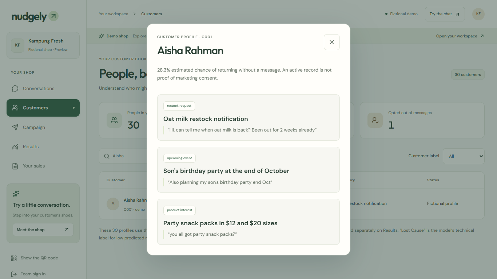
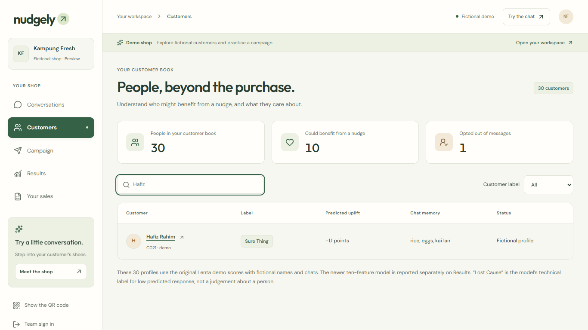
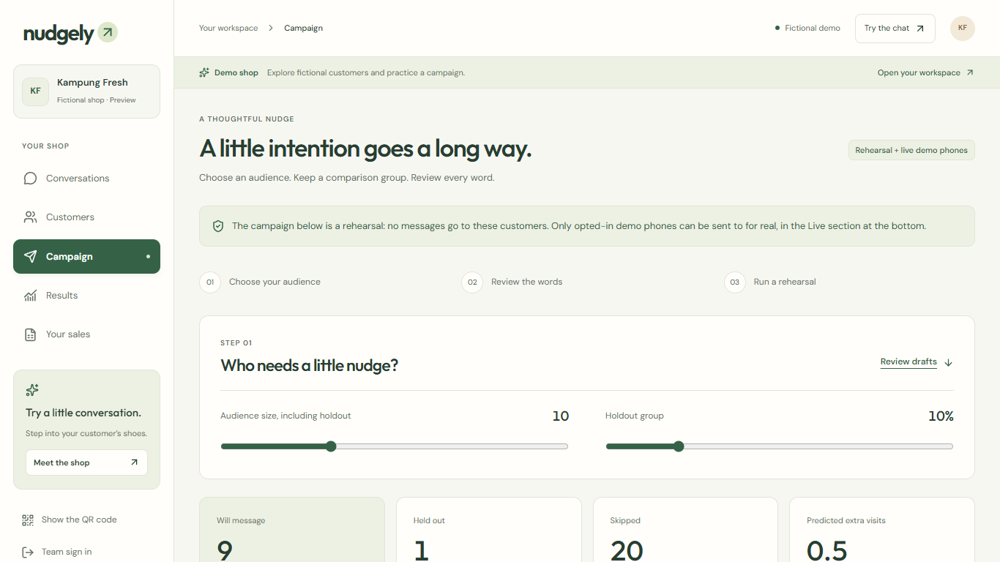
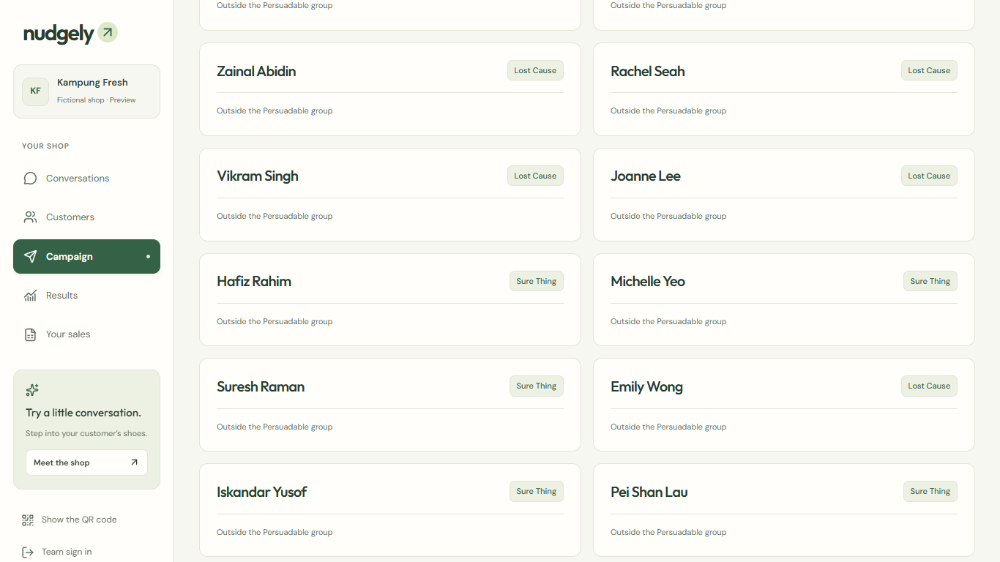
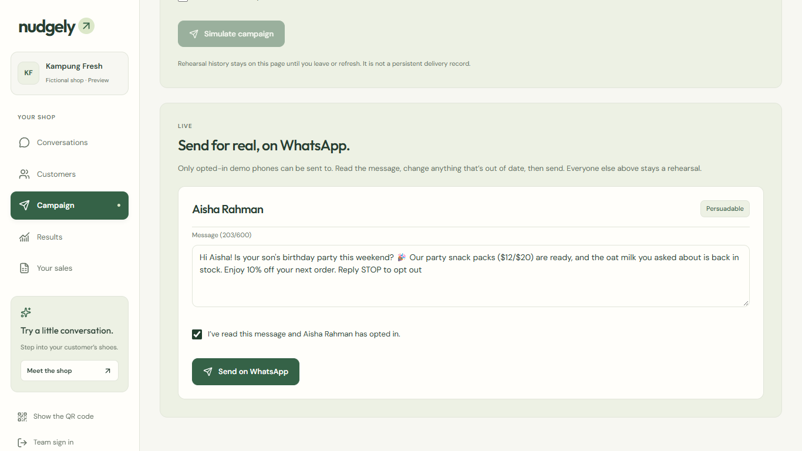
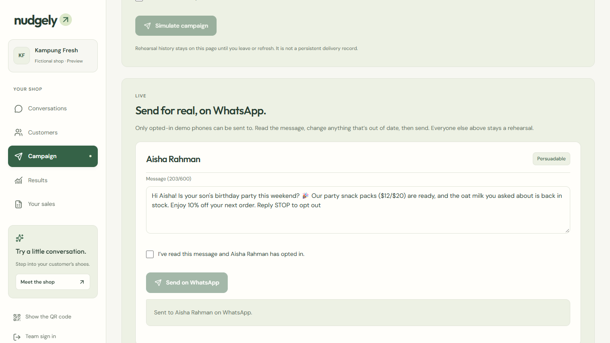
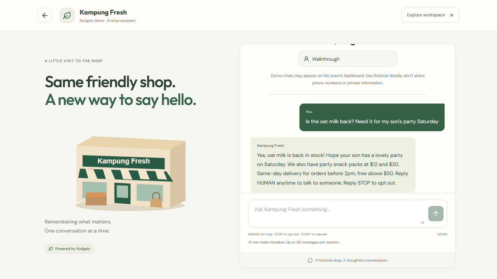
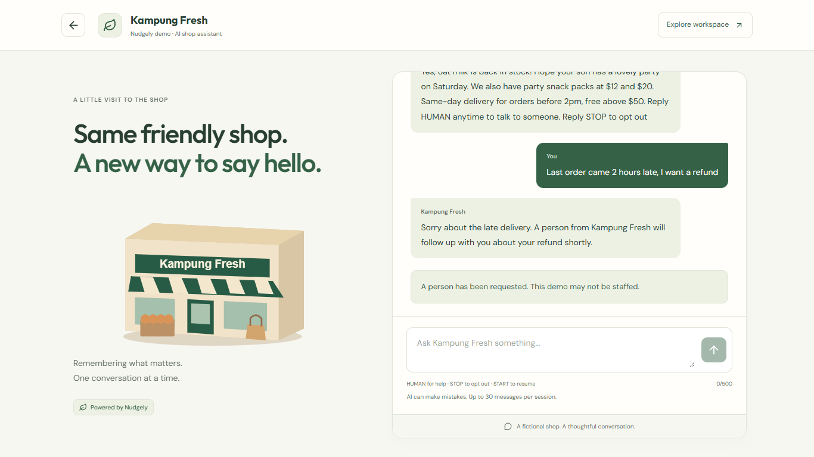
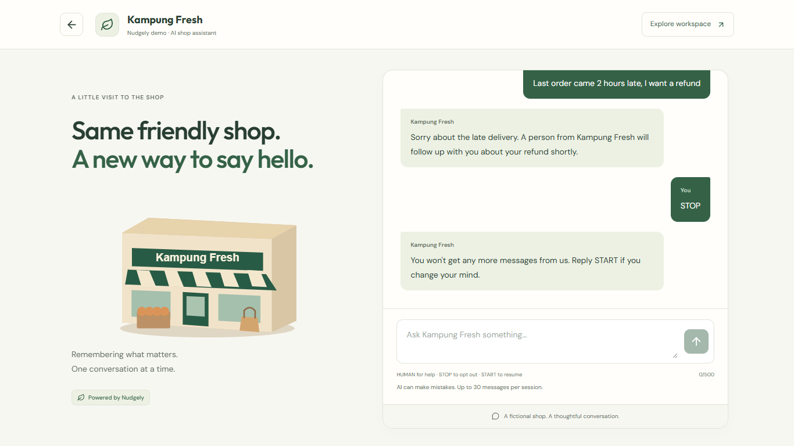
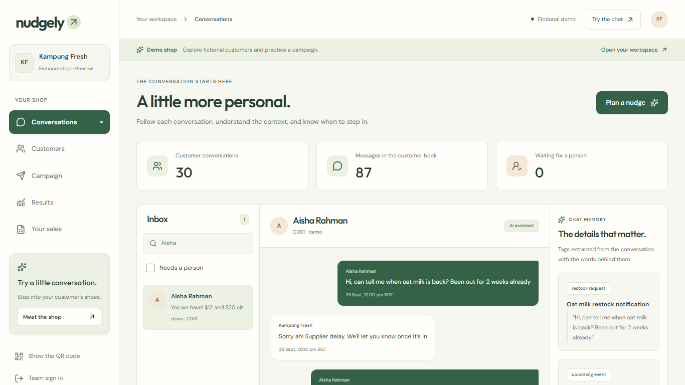

# Demo walkthrough with screenshots (for Shareef and Thuta)

The 4-minute live demo from [Pitch_Plan.md](Pitch_Plan.md) section 3, one picture per step. Words to say are in the plan;
this page shows **what you should see**. Screen recording of the click path: [demo/demo-click-path.webm](demo/demo-click-path.webm)
(opens in Chrome).

**How these were made (13 Nov):** captured from the live site by `web/scripts/demo-walkthrough.mjs`.
- Steps 1–7 use **`/demo`**, the public copy of the dashboard with the same Aisha and Hafiz. On stage you use **`/dashboard`** (signed in), which looks the same.
- Step 5's Live panel only appears for a signed-in team account, so for these pictures the "send" was intercepted and **no message went out**.
- Steps 6–8 are the **real AI** answering live on the web chat. On stage the same AI answers on WhatsApp.
- One difference: `/demo` still says Aisha's party is "end of October". The live dashboard says mid-November, and her draft says "this weekend".

**Stage layout:** Chrome split screen. Left: the dashboard. Right: WhatsApp Web on Aisha's phone (Thuta), opened on the chat with
+1 555-164-9508. Add photos of the real WhatsApp side here after the first full run-through.

---

## 1 · Customers → Aisha (0:40)

Search "Aisha", open her profile. Point at the two things Nudgely remembered, each with her own words.



## 2 · Hafiz is a Sure Thing (1:10)

Search "Hafiz". Label **Sure Thing**, predicted uplift **−1.1 points**: a message wouldn't change what he does.



## 3 · Campaign: who gets a message (1:25)

The model picked 9 to message and held 1 back as the comparison group. It skipped 20, including Hafiz.



Optional: open **Skipped** to show Hafiz with the reason "Outside the Persuadable group".



## 4 · Live: read, tick, send (1:55)

Scroll to **Live**. Edit a word so judges see it's editable, tick *I've read this message*, then **Send on WhatsApp** and confirm.



After sending:



> **On stage:** the message arrives in Aisha's WhatsApp on the right half of the screen. *(Add a photo after the first real run.)*

## 5 · Aisha replies, the AI answers from her history (2:30)

Thuta types: **"Is the oat milk back? Need it for my son's party Saturday"**. The reply takes about 6–10 s; keep talking while it comes.
Then open **Conversations → Aisha** to show the new tags.



## 6 · Refund: a person takes over (3:15)

Thuta types: **"Last order came 2 hours late, I want a refund"**. The AI doesn't promise a refund; it hands over.
On the dashboard, Aisha's conversation gets the **Needs a person** flag.



## 7 · STOP (3:50)

Thuta types: **STOP**. She gets a confirmation and the dashboard shows **Opted out**.



## Back to the slides (4:20)

"Everything you just saw happened live. Jack?"

---

## Where things are on the dashboard



- **Inbox** (left): search box and the *Needs a person* filter
- **Chat** (middle): the full WhatsApp or web conversation
- **Chat memory** (right): tags with the customer's exact words

## After every rehearsal

```bash
python scripts/reset_demo_customer.py --yes
```

Then Aisha's phone sends the bot "hi" again (re-opens WhatsApp's 24-hour window). To retake these screenshots:
`cd web && node scripts/demo-walkthrough.mjs`.
