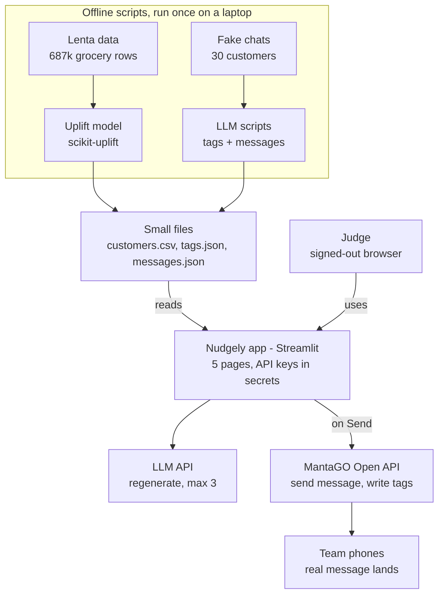

# Nudgely PRD

Oct 21, 2026 · Thuta

Nudgely picks which customers to message (uplift model), writes each one a personal message from their own chat history (LLM), sends it through MantaGO, and proves the effect against a no-message comparison group. MVP is due Oct 23, 2026.

## Goal and scope

Ship a deployed web app that judges can try in a signed-out browser, showing one full retention campaign from customer data to a sent MantaGO message, plus proof the method works.

**Problem:** small businesses blast the same "We miss you, 10% off" to everyone and never know if it worked.

**Target user:** owner or marketer of a small retail or F&B business using MantaGO. Demo business: a fictional Singapore grocer, "Kampung Fresh".

**Evidence we build on (real, already computed):**

| Dataset | No message | Got message | Effect |
| --- | --- | --- | --- |
| Hillstrom, 64k shoppers, email (both email groups) | 10.6% visited, 0.57% bought | 16.7% visited, 1.07% bought | +57% visits, about 1.9x purchases (best email, men's: +72% visits, 2.2x purchases) |
| Lenta, 687k grocery customers, SMS | 10.3% visited | 11.0% visited | +7% visits |
| Lenta, our uplift model (test set) | Random 30% of customers | Model's top 30% | 53% of extra visits vs 30%, about 1.8x (noisy: 90% interval 31–89%) |

All figures: [docs/Numbers.md](Numbers.md).

**In scope (MVP):**

- Uplift model trained offline on Lenta, scores saved to CSV
- 30 demo customers: real Lenta feature rows + fake names + fake chat histories
- LLM tag extraction from chats and personal message writing
- Campaign builder: budget, holdout %, preview messages
- Live send through MantaGO to the team's own test accounts (one channel)
- Tags written back to MantaGO
- Results page: comparison-group chart from Lenta test data

**Out of scope (say "planned" in the pitch):**

- Live learning loop and retraining from new results
- Real customer database or POS/e-commerce integration
- Multi-channel sending
- Reading live replies from MantaGO callbacks
- Customer Twin Test Room

## User journey

The judge runs one campaign end to end in under 2 minutes, with no login.

1. **Home:** sees the problem in one line and the proof chart (messaged vs not messaged).
2. **Customers:** sees 30 Kampung Fresh customers with an uplift score and a label: Persuadable, Sure Thing, Lost Cause.
3. **Customer detail:** opens one customer, sees their chat history and the tags the LLM pulled out (e.g. "wants oat milk restock").
4. **Campaign builder:** sets message budget (e.g. top 10 customers) and holdout (10%). App shows who gets messaged, who is held out, and who is skipped, with a reason for each.
5. **Preview:** sees the personal message for each chosen customer. Can regenerate one message live (rate-limited).
6. **Send:** clicks Send. Customers mapped to team test accounts get a real MantaGO message; the rest show "sent (simulated)". Status shows per customer.
7. **Results:** sees the comparison-group chart from Lenta test data and the expected extra visits for this campaign.

## Features

Seven features; all must work for submission except F6, which is nice to have.

| ID | Feature | Must / Nice | Acceptance criteria |
| --- | --- | --- | --- |
| F1 | Uplift scoring | Must | Two-model uplift (HistGradientBoosting) trained on 50% Lenta sample. Outputs per customer: p_no_msg, p_msg, uplift. Test-set decile table and "top 30% captures X% of extra visits" saved to CSV. |
| F2 | Customer labels | Must | Persuadable = uplift in top 30%. Sure Thing = not Persuadable and p_no_msg in top 30%. Lost Cause = everyone else. Shown as a badge. |
| F3 | Chat Memory extraction | Must | For each of 30 demo customers, LLM returns valid JSON tags (schema in LLM spec). Results cached in tags.json; the app never calls the LLM on page load. |
| F4 | Message writer | Must | One message per chosen customer, max 300 characters, uses at least one tag, includes opt-out line, discount cap 10%. Cached; live regenerate max 3 per session. |
| F5 | Campaign + send | Must | Budget and holdout sliders. Random holdout with fixed seed. Send calls MantaGO broadcast for mapped test accounts and logs status (sent / failed / simulated). |
| F6 | Tag write-back | Nice | Extracted tags assigned to the customer in MantaGO via tag API. |
| F7 | Results page | Must | Chart: visit rate, no message vs message, plus top 30% vs random 30%. Numbers from F1 output, labelled with dataset name. |

## Architecture

Model training and LLM generation run once offline; the deployed app only reads small files and calls MantaGO when the user clicks Send.



**Stack:** Python 3.11, pandas, scikit-learn, scikit-uplift, Streamlit (deployed on Streamlit Community Cloud), `requests` for MantaGO, one LLM SDK. Repo layout: `notebooks/` (A), `scripts/` (B: `extract_tags.py`, `write_messages.py`), `nudgely/mantago.py` (C), `app/` (D), `data/` (small files only), `README.md`.

## Data

All heavy work runs offline; the deployed app only reads small CSV and JSON files.

| File | Made by | Contents |
| --- | --- | --- |
| `lenta_scored_test.csv` | F1 notebook | Test-set rows: treatment, visit, uplift, decile. Used for the results chart. |
| `uplift_summary.json` | F1 notebook | Visit rates, decile table, top-30% capture share. |
| `customers.csv` | F1 + B | 30 demo customers: `customer_id, name, channel, mantago_client_id, p_no_msg, p_msg, uplift, label` + a few readable features (visits per month, avg spend, days since last visit). |
| `chats.json` | B | `{customer_id: [{from: "customer" or "store", text, date}]}`, 3 to 8 messages each. |
| `tags.json` | F3 script | LLM output per customer (schema in LLM spec). |
| `messages.json` | F4 script | Draft message per customer + which tags it used. |
| `send_log.csv` | App | `timestamp, customer_id, status, mantago_response`. |

**Demo customers:** sample 30 real Lenta test rows (10 per label so all three show up), give each a fake name, and write a chat history that fits a grocer. Map 3 to 5 of them to team members' own MantaGO test accounts (`mantago_client_id`) so the send is real.

**Chat themes to cover:** restock request, late delivery complaint, price complaint, upcoming event (birthday party, CNY), product question, happy regular. Mix English and Singlish lightly so it looks real.

**Memory note:** full Lenta (687k x 195) ran out of memory on a 7 GB machine. Train on a 50% sample as float32.

## MantaGO integration

MantaGO delivers the message and stores tags; Nudgely decides who and what. All calls run server-side with keys in Streamlit secrets.

**Setup (do first, day 1):**

1. Create the bot at mantago.cc; copy `botId` from the URL (`mantago.cc/chatbot/<botId>`).
2. Connect one channel. Pick whichever works fastest for the team (Messenger, Instagram, LINE or WhatsApp).
3. Get the Open API token and secret key (docs: "How to get a Token").
4. Each of 3 to 5 teammates messages the bot once, so they appear as members. Read their `clientId` from the member list API and put it in `customers.csv`.
5. Send one test message to yourself with the broadcast call below.

| Call | Method + path | Body | Used for |
| --- | --- | --- | --- |
| Refresh token | `POST https://mantago.cc/api/openapi/token?botId=<botId>` | `{secret}`, header `Authorization: Bearer <token>` | When a call returns code 1004 (token expired) |
| Send message | `POST https://mantago.cc/api/openapi/broadcast?botId=<botId>` | `{secret, platform, name, message, clientIds:[...]}`; Facebook also needs `fbTag` | F5 send, one call per customer (personal text) |
| Member list / profile | Member API (see Postman) | `{secret}` | Get `clientId`, tags, `lastInteractAt` |
| Tags | Manual / personalised tag API: create tag, assign tag to user (see Postman) | `{secret, name}` | F6 write-back |

`platform` must be one of `line`, `facebook`, `instagram`, `whatsapp`. Exact tag endpoint paths are in the [Postman collection](https://documenter.getpostman.com/view/39154303/2sAYkKKJfg); check them on day 1.

**Unknowns to ask Eslitec:** what the callback URL receives (reply events?), how auto tags are applied, rate limits, and whether a free trial bot can use the Open API.

## LLM spec

Two prompts, both run as offline scripts that cache output; use one fast, cheap model via a paid API key and force JSON output.

**Prompt 1: Chat Memory extraction (F3).** Input: one customer's chat history with names and phone numbers removed. Output schema:

```json
{
  "customer_id": "C017",
  "tags": [
    {"type": "restock_request", "value": "oat milk", "evidence": "can tell me when oat milk is back?", "date": "2026-09-30"}
  ],
  "sentiment": "positive | neutral | negative",
  "open_promise": "Store promised to notify when oat milk is back",
  "best_hook": "oat milk back in stock",
  "avoid": "discount talk, customer complained about price pushiness"
}
```

Allowed tag types: `restock_request`, `complaint_delivery`, `complaint_price`, `upcoming_event`, `product_interest`, `loyal_regular`. Every tag must quote evidence from the chat; drop tags without evidence.

**Prompt 2: Message writer (F4).** Input: customer first name, label, readable features, the extraction JSON, store info and current offers. Rules:

- Max 300 characters, friendly Singapore tone, no emoji spam
- Lead with `best_hook`; never invent stock, prices or offers not in the store info
- Respect `avoid`; complaint tags get an apology first, not a sale
- Discount only if label is Persuadable and capped at 10%
- End with: "Reply STOP to opt out"

Output: `{customer_id, message, tags_used:[...], reason}`. The `reason` (one line) shows in the app so the owner sees why.

**Cost control:** 30 customers x 2 prompts is about 60 calls per full run. Live regenerate in the app is capped at 3 per session.

## Dashboard screens

Five Streamlit pages in a sidebar, one per journey step group.

| Page | Shows | Main controls |
| --- | --- | --- |
| 1. Overview | One-line problem, 3 headline numbers (+57% visits, 1.9x purchases, 1.8x targeting), proof chart (spec; the current app shows the 53% chart and its interval) | None |
| 2. Customers | Table of 30 customers: name, label badge, uplift, days since last visit, top tag | Filter by label; click row to open detail |
| 3. Customer detail | Chat history (bubbles), extracted tags with evidence quotes, draft message + reason | Regenerate message (rate-limited) |
| 4. Campaign | Budget slider, holdout % slider; three lists: Will message, Held out, Skipped (with reason); message previews | Send button; per-customer status after send |
| 5. Results | Decile chart (lift per decile), message vs no message bars, expected extra visits for this campaign, limitations note | None |

**Look:** clean, one brand colour, Nudgely name and tagline on every page. Add a "How to try this" box on page 1 for judges.

## Success metrics and responsible AI

The core metric is retention lift: repeat-visit rate of messaged customers minus that of the held-out group.

| Metric | How measured | MVP source |
| --- | --- | --- |
| Retention lift | Visit rate (messaged) minus visit rate (held out) | Lenta test set |
| Targeting efficiency | Share of extra visits captured by top 30% vs 30% random | Lenta test set (53% vs 30%) |
| Messages saved | Customers skipped vs "message everyone" | App campaign |
| Message quality | Every message uses a real tag with evidence; no invented facts | Manual check of 30 messages |

**Responsible AI (mandatory in judging):**

- Disclose: chats and names are fake; results come from public datasets; no live customer test yet
- Consent: message only customers who opted in; every message has "Reply STOP to opt out"
- Privacy: strip names and phone numbers before chat text goes to the LLM; no API keys in code or GitHub
- Fairness: model uses behaviour features only; do not use gender for targeting (drop it from Lenta features)
- Human in control: owner previews every message before Send

## Team roles and timeline

Five people, three days; MantaGO setup starts first because it is the riskiest part.

| Person | Owns | Wed 21 Oct | Thu 22 Oct | Fri 23 Oct |
| --- | --- | --- | --- | --- |
| A: Data/ML | F1, F2, F7 data | Retrain uplift on Lenta without gender; save scored test CSV + summary JSON | Pick 30 demo rows; build `customers.csv`; make chart data | Final numbers check |
| B: LLM | F3, F4 | Write `chats.json` (30 customers); draft prompt 1 | Prompt 2; run both scripts; hand-check all 30 outputs | Fix bad messages |
| C: MantaGO + backend | F5, F6 | Bot, channel, token, first test send to own phone | `mantago.py` client: send, member list, tags; map test `clientId`s | Live send rehearsal |
| D: App + deploy | Pages 1 to 5 | Streamlit skeleton with dummy data; deploy to Streamlit Community Cloud early | Wire real files + C's client; secrets; rate limit | Signed-out browser test; README |
| E: Pitch + docs | Submission | Deck outline; one-page brief draft; 150-word summary | Slides with real numbers; video script | Record 7-min video; final deck; submit form |

**Checkpoints:**

- [ ] Wed 11pm: first MantaGO message received on a phone; uplift CSVs saved
- [ ] Thu 6pm: full flow works locally, customers to send
- [ ] Thu 11pm: deployed link works signed out
- [ ] Fri 3pm: video, deck, brief done; all links open without access requests
- [ ] Fri, well before deadline: form submitted, all 5 members reviewed it

## Risks, fallbacks and open questions

The biggest risk is MantaGO API access; every risk has a fallback that keeps the demo working.

| Risk | Fallback |
| --- | --- |
| MantaGO token or channel setup blocked | Ask Eslitec on Telegram day 1. Meanwhile app marks messages "ready to send"; send one by hand in MantaGO for the video |
| Tag API paths unclear | Skip F6; show tags in the app only |
| LLM writes invented facts | Strict rules in prompt 2; hand-check all 30 cached messages |
| Judges' clicks burn API credits | Cached outputs; live regenerate max 3 per session |
| Lenta too big for laptop or cloud | Train offline on 50% sample; deploy only small CSVs |
| Numbers shift after dropping gender | Re-run done: the figure is now 53% (`data/uplift_summary.json`), updated everywhere |

**Open questions:**

- [x] Which problem statement number is ours (1 or 2)? **Problem Statement 1**
- [x] Exact team name as registered: **Nudgely**
- [x] Lenta dataset licence terms: no explicit licence is published. Source is the BigTarget Hackathon by Lenta and Microsoft (2020), distributed through scikit-uplift. Disclosed as non-commercial research and demo use (see `docs/Responsible_AI.md`)
- [x] Submission deadline time on 23 Oct: **11:59 PM SGT**
- [x] Which LLM provider we use: free tiers. OpenRouter free models and Google Gemini for tags, Gemini for the 15 drafts so far (confirm with Jack)

## Sources

- [MantaGO Open API docs index](https://doc.mantago.cc/llms.txt)
- [MantaGO broadcast API](https://doc.mantago.cc/wen-jian-shuo-ming-1/yong-hu-tui-bo.md)
- [MantaGO post-checkout message example](https://doc.mantago.cc/qing-jing-fan-li/gou-wu-ju-xia-dan-hou-tui-bo-xun-xi.md)
- [MantaGO Postman collection](https://documenter.getpostman.com/view/39154303/2sAYkKKJfg)
- [Hillstrom dataset (scikit-uplift)](https://www.uplift-modeling.com/en/latest/api/datasets/fetch_hillstrom.html)
- [Uplift modelling (Wikipedia)](https://en.wikipedia.org/wiki/Uplift_modelling)
- Lenta and Hillstrom figures: computed by the team with scikit-uplift, 21 Oct 2026
