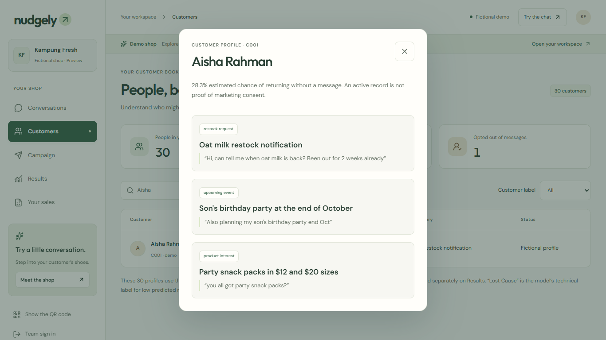
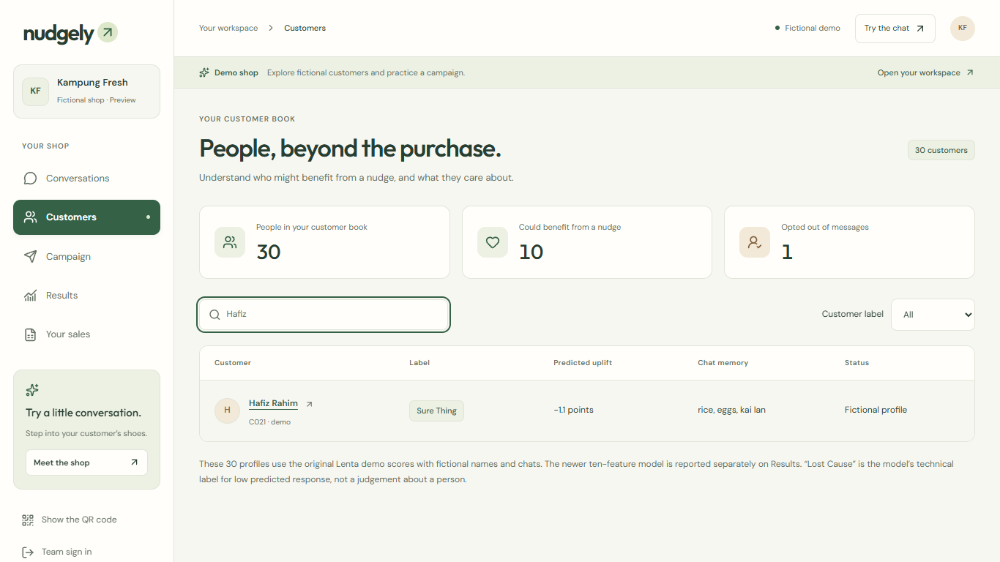
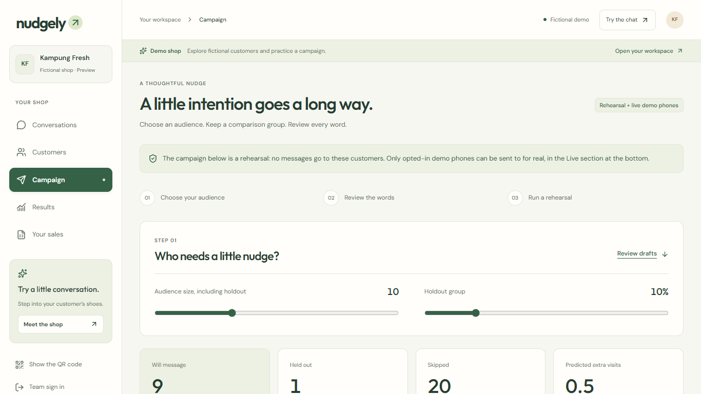
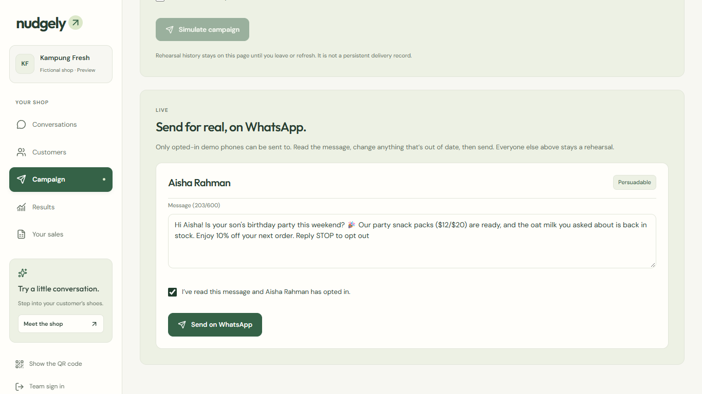
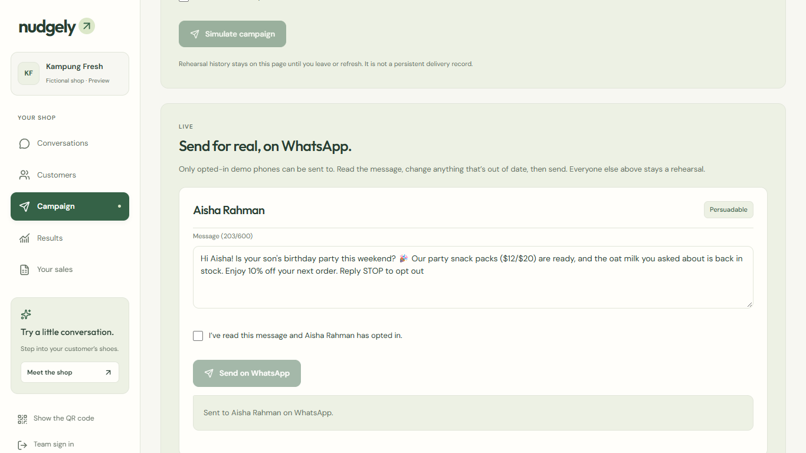
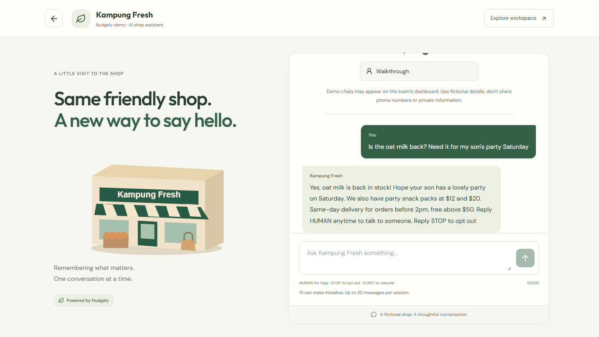
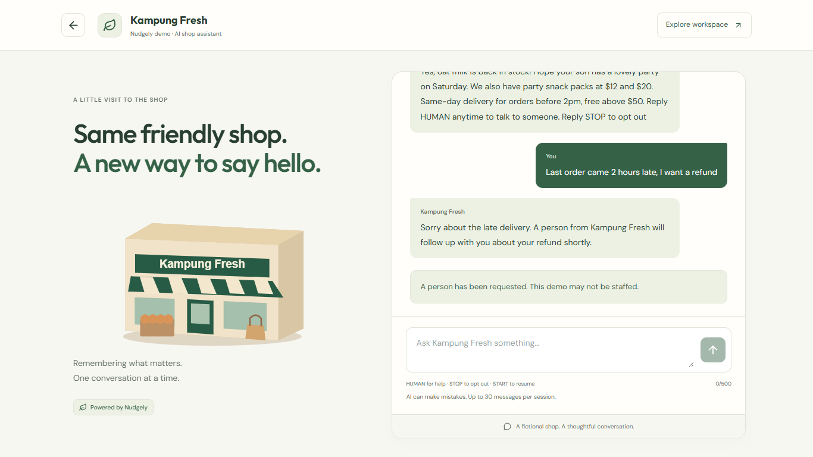
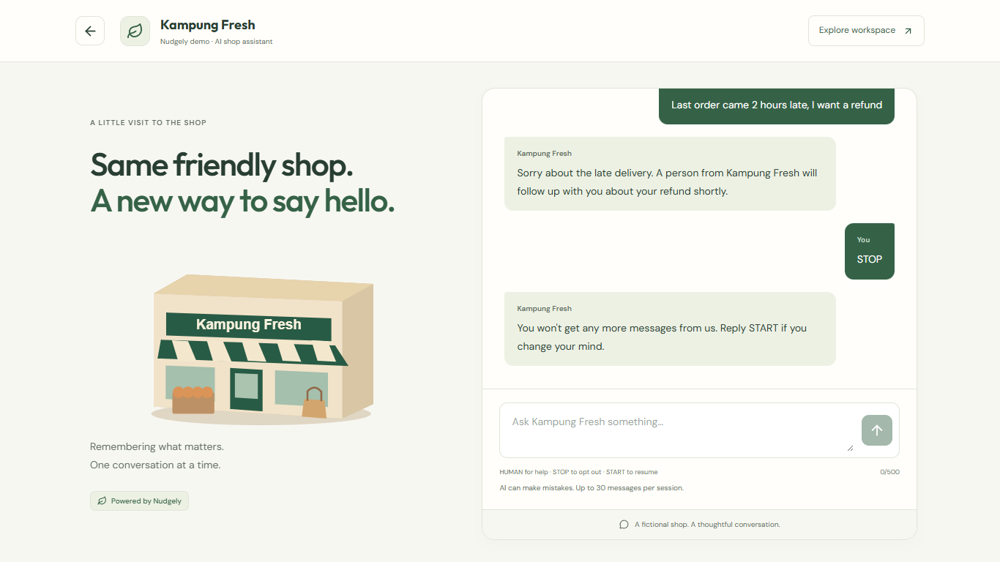

# Shareef's demo guide: the 4-minute live demo

For: **Shareef** (presenting the demo on Thuta's laptop). Saturday 14 Nov 2026, AI-GNITION finals.
You come in at **0:40**, when Jack says *"Shareef is Mei Ling for the next four minutes."* You hand back at **4:40** with *"Jack?"*

You play **both people**:
- **Mei Ling**, the shop owner, on the dashboard (left half of the screen)
- **Aisha**, her customer, in WhatsApp Web (right half of the screen). It's Thuta's real WhatsApp, which is the demo phone.

Everything in the demo is **live**: a real WhatsApp message goes out and the real AI answers. That's the point. The organisers' rules say *show the solution working* and *never present a recording as live*.

Full pitch: [Pitch_Plan.md](Pitch_Plan.md) · Screenshots below are from the live site (13 Nov). On stage the dashboard is the signed-in
`/dashboard`, which looks the same as these.

---

## Part 1 · Set up the laptop

### Friday (rehearsal day)
- [ ] Thuta has added `LIVE_RECIPIENTS` in Render (his WhatsApp number as Aisha, C001). Without it the **Live** section never appears.
- [ ] In Thuta's WhatsApp, save **+1 555-164-9508** as a contact named **Kampung Fresh**.
- [ ] Do **two full timed run-throughs** with this guide. After each one, Thuta resets Aisha: `python scripts/reset_demo_customer.py --yes`.
- [ ] Dythan screen-records one clean run (Win + Alt + R). That's the backup video.

### Saturday morning, before the venue
- [ ] Thuta resets Aisha once more.
- [ ] From Thuta's WhatsApp, send **`hi`** to Kampung Fresh. **Why:** WhatsApp only lets a shop send a free-text message to someone who messaged it in the last 24 hours. Without this, the Send button refuses. It's valid until Sunday morning.
- [ ] Open https://nudgely-api.onrender.com/health once. It should show `"ok":true`. This wakes the server.

### 5 minutes before going on
- [ ] **Chrome, split screen.** Left half: https://nudgely-navy.vercel.app/dashboard (signed in). Right half: https://web.whatsapp.com.
- [ ] **Privacy:** open the **Kampung Fresh** chat in WhatsApp Web, then make the right window narrow enough that the **chat list disappears** and only the conversation shows. Thuta's other chats must never be on the projector. If the list won't hide, zoom out until only the chat fits, or scroll the list so nothing personal shows.
- [ ] Dashboard on **Customers**, search box empty.
- [ ] Windows notifications **off** (Focus / Do not disturb), WhatsApp desktop notifications off, phone on silent, laptop sleep off, charger in.
- [ ] Browser zoom so the text is readable from the back (110–125%).

---

## Part 2 · The demo, step by step

Each step has **Do** (clicks), **Say** (your words), **Why** (what it proves to the judges) and **You should see**. The *Why* lines
match the judges' checklist for our challenge: *personalised response, a decision branch, what triggers the conversation, opt-out,
hand-over to a person, and how the business measures the result.* Don't read the *Why* aloud; it's so you know what each step is for.

| Clock | Step | Screen |
|---|---|---|
| 0:40 | 1. Meet Aisha | Dashboard → Customers |
| 1:10 | 2. Hafiz gets skipped | Dashboard → Customers |
| 1:25 | 3. The campaign decides | Dashboard → Campaign |
| 1:55 | 4. Approve and send | Campaign → Live |
| 2:20 | 5. It arrives | WhatsApp |
| 2:30 | 6. Aisha asks, the AI answers | WhatsApp + Conversations |
| 3:15 | 7. A refund goes to a person | WhatsApp + Conversations |
| 3:50 | 8. STOP | WhatsApp + Conversations |
| 4:20 | 9. Hand back | Slides |

### Step 1 · Meet Aisha (0:40, 30 s)

**Do:** Customers → type **Aisha** in the search → click **Aisha Rahman**.

**Say:** "This is Mei Ling's customer book. Here's Aisha. A few weeks ago she asked if oat milk was back, and mentioned her son's birthday party. Nudgely kept both, with her own words. And the model marks her *Persuadable*: a message is likely to bring her back."

**Why:** shows the **customer and segment**, and that Nudgely remembers **what the customer said**, with proof. Judges can see the exact words behind each tag, so nothing is made up.

**You should see:**



*(On the live dashboard the party says mid-November; this picture is the public demo copy.)*

### Step 2 · Hafiz gets skipped (1:10, 15 s)

**Do:** close Aisha (Esc) → search **Hafiz** → point at **Sure Thing** and **−1.1 points**.

**Say:** "Hafiz is the opposite. He comes in every Saturday anyway. Sending him '10% off' just gives away Mei Ling's margin."

**Why:** this is the **decision branch** and our core difference. Most tools message everyone; we only message people a message actually changes.

**You should see:**



### Step 3 · The campaign decides (1:25, 30 s)

**Do:** click **Campaign**. Point at **Will message 9 · Held out 1 · Skipped 20**. Don't touch the sliders.

**Say:** "So the campaign messages nine people, skips twenty, Hafiz included, and holds one back who gets nothing. That held-back group is how Mei Ling finds out if her messages actually brought people back."

**Why:** shows **how the business measures the result**: a no-message comparison group, not open rates. It's the judges' "how will you measure retention?" question, answered on screen.

**You should see:**



### Step 4 · Approve and send (1:55, 25 s)

**Do:** scroll to the bottom → **Live** section → Aisha's message. Click in the box and **change one word** (for example "ready" → "waiting for you"). Tick **I've read this message and Aisha Rahman has opted in**. Click **Send on WhatsApp** → **OK** on the confirm box.

**Say:** "Here's the message the AI wrote for her: her son's party, the oat milk. Nothing goes out until Mei Ling reads it, changes what she wants, and approves it. Send."

**Why:** shows **what triggers the conversation** (the shop sends a nudge to someone the model chose), and **human approval before anything goes out**.

**You should see:** before sending, then "Sent to Aisha Rahman on WhatsApp."





### Step 5 · It arrives (2:20, 10 s)

**Do:** point at the right half: the message appears in the Kampung Fresh chat.

**Say:** "And that's a real WhatsApp message on Aisha's phone. Now I'm Aisha."

**Why:** proves it's **live**, not a mock-up. This is the moment judges remember.

### Step 6 · Aisha asks, the AI answers (2:30, 45 s)

**Do:** in WhatsApp Web type exactly:

> **Wah thanks! Is the oat milk really back? Need it for my son's party Saturday**

Press Enter. **While you wait 6–10 s**, click **Conversations** on the dashboard and open Aisha. When the reply arrives, point at it, then at the new tag on the right (*Chat memory*).

**Say (while waiting):** "She's now talking to the shop's AI assistant, not to Mei Ling. Watch Mei Ling's inbox…" **(when it arrives):** "It answered from what it knows about her, the party, the oat milk, and it noted what she just said. Every note shows the words it came from."

**Why:** the **personalised response**: the reply uses her history, not a generic script. The new tag shows the AI keeps learning from each conversation.

**You should see** (this picture is the same AI on our web chat; on stage it's WhatsApp):



### Step 7 · A refund goes to a person (3:15, 35 s)

**Do:** type exactly:

> **Last order came 2 hours late, I want a refund**

When it replies, point at the **Needs a person** flag on Aisha's conversation in the dashboard.

**Say:** "Now something an AI shouldn't decide. It doesn't promise a refund. It tells her a person will follow up, and flags Mei Ling."

**Why:** **hand-over to a person**. Judges want to see the bot know its limits: refunds, complaints and anything it can't verify go to a human.

**You should see:**



### Step 8 · STOP (3:50, 25 s)

**Do:** type **STOP** and send. Point at the confirmation, then at **Opted out** on the dashboard.

**Say:** "And if she's had enough, one word. She's out of every future campaign, automatically."

**Why:** **opt-out**. Consent is a judging point; it shows the customer is always in control.

**You should see:**



### Step 9 · Hand back (4:20)

**Do:** switch to the slides (or nod to Dythan).

**Say:** "Everything you just saw happened live. Jack?"

**Why:** say "live" once, clearly. Jack takes over with *How it works*.

---

## Part 3 · If something goes wrong (decide in 5 seconds)

| What happens | What you do and say |
|---|---|
| No **Live** section at the bottom of Campaign | Thuta's Render setting is missing. Say: "Let me show you the recorded run." Dythan plays the backup video. Say clearly it's the recording |
| Send says something about **24 hours** | In WhatsApp Web send **hi** to Kampung Fresh, wait 5 s, click Send again |
| Any other send error | Backup video: "Here's our recorded run of this step" |
| No AI reply after 20 s | "The venue Wi-Fi is slow; here's the recording of this step." Backup video |
| Dashboard doesn't update | Refresh the dashboard once. If still nothing, just show the WhatsApp side |
| You're past **4:40** | Skip STOP. Jack mentions opt-out in his part |
| The reply says something odd | Read it out calmly and move on. **Never** retry on stage |

**Never** say a recording is live. The organisers said so explicitly.

## Part 4 · Q&A questions that are yours

Answer first in one sentence, then the reason. 30–45 seconds each. Jack takes AI, data and model questions.

| Question | Your answer |
|---|---|
| What's working now and what's proposed? | Working: WhatsApp and web chat with the live AI, memory tags with evidence, hand-over, STOP, the dashboard and the live send you just saw. Proposed: a real business number and a pilot shop |
| What starts and ends the conversation? | It starts when the owner approves a nudge for someone the model picked, or when the customer writes first. It ends when the question's answered, a person takes over, or they send STOP |
| What needs human approval? | Every message a shop sends out. The AI only replies to customers who wrote first, and hands over when unsure |
| How does the owner see if it worked? | Every campaign keeps a held-back group. In a pilot we compare their return visits with the messaged group from the shop's sales |
| Isn't this just SleekFlow or WATI? | They're great at sending; you pick who gets what by hand and see opens, not extra visits. We decide who and what, and prove it. We'd plug into them as the sender |
| Who is this for? | Neighbourhood shops that already sell on WhatsApp but have no marketing team |

## Part 5 · After each rehearsal (Thuta)

```bash
python scripts/reset_demo_customer.py --yes
```

Then send **hi** to Kampung Fresh from WhatsApp again. Aisha is back to her starting state: not opted out, no flag, no new messages.
