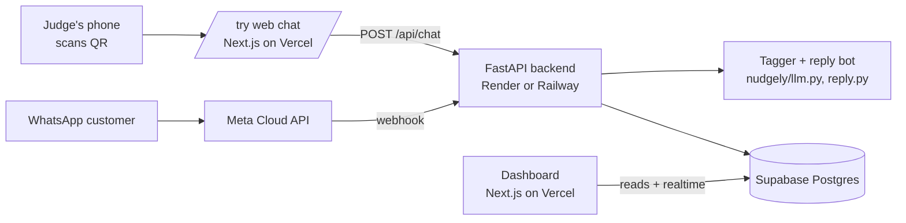

# Nudgely v1: architecture and contract (frontend ↔ backend)

The contract lets Dythan (frontend) and Thuta (backend) build at the same time. Change it only by agreement.



- **Backend (Thuta, with Claude):** FastAPI in `api/`. Wraps the existing Python (`nudgely/`), receives the WhatsApp webhook and the web chat, writes everything to Supabase. Deployed publicly, so there's **no laptop tunnel on demo day**.
- **Frontend (Dythan, with Codex):** Next.js in `web/`. Landing page, `/try` web chat, dashboard. Reads Supabase directly (with realtime for the live view) and calls the backend only for chat.

## Supabase tables

```sql
create table customers (
  id           text primary key,          -- 'WA001' for WhatsApp, 'WEB001' for web chat
  channel      text not null,             -- 'whatsapp' | 'web'
  name         text,                      -- display name only; never store phone numbers here
  label        text default 'New',        -- Persuadable | Sure Thing | Lost Cause | New
  uplift       real,
  handover     boolean default false,     -- needs a person
  opted_out    boolean default false,
  created_at   timestamptz default now(),
  last_seen_at timestamptz default now()
);

create table messages (
  id           bigint generated always as identity primary key,
  customer_id  text references customers(id) on delete cascade,
  sender       text not null,             -- 'customer' | 'store'
  text         text not null,
  handover     boolean default false,     -- this store reply was a handover
  created_at   timestamptz default now()
);

create table tags (
  id           bigint generated always as identity primary key,
  customer_id  text references customers(id) on delete cascade,
  type         text not null,             -- restock_request | complaint_delivery | complaint_price | upcoming_event | product_interest | loyal_regular
  value        text not null,
  evidence     text not null,             -- the customer's own words
  created_at   timestamptz default now(),
  unique (customer_id, type, value)
);
```

- Turn on **Realtime** for `messages`, `customers` and `tags` (the live dashboard listens to inserts).
- The 30 Kampung Fresh demo customers (scores, labels) are seeded from `data/customers.csv`.
- **RLS:** the backend writes with the service key. The dashboard reads with the anon key behind login. The `/try` page never reads the database directly: it only calls `/api/chat`.
- WhatsApp numbers stay in the backend only (hashed if stored at all). The dashboard shows names and ids.

## Backend API

| Method | Path | Body | Returns |
|---|---|---|---|
| `POST` | `/api/chat` | `{"session_id": "<random uuid from the browser>", "name": "Judge 1", "text": "Do you have durian?"}` | `{"reply": "...", "handover": false, "tags": [{"type", "value", "evidence"}], "customer_id": "WEB003"}` |
| `GET` | `/whatsapp` | Meta's verification check | the challenge |
| `POST` | `/whatsapp` | Meta's webhook | `200` |
| `GET` | `/health` | | `{"ok": true}` |

- `/api/chat` is rate-limited per session (about 1 message every 2 s, 30 per session) so a judge can't run up the AI bill.
- The same STOP / START / HUMAN rules apply on the web chat as on WhatsApp.
- Reply time is about 3–6 s (Claude Haiku 5.5 via OpenRouter), so the UI should show a typing indicator.

## Judge QR flow

1. The QR code on screen and on the deck goes to `https://<site>/try`
2. The judge types a name (optional) and chats with Kampung Fresh
3. The big-screen dashboard shows the new customer, their tags and the bot's replies live
4. Stretch: a second QR code, `https://wa.me/<real number>?text=Hi%20Kampung%20Fresh`, opens real WhatsApp, once a real number is approved
